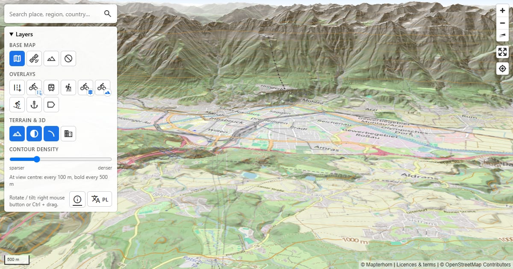

# Open 3D Terrain Map

I kept coming across great open maps – [Mapterhorn](https://mapterhorn.com), [OpenRailwayMap](https://www.openrailwaymap.org), [OpenTopoMap](https://opentopomap.org), [CyclOSM](https://www.cyclosm.org) and many more – but I couldn't find a single place that had them all at hand. So I made one for myself.

It is a full-screen 3D map in a single `index.html` file (MapLibre GL JS + [Mapterhorn](https://mapterhorn.com) elevation data). The interface is in English, or in Polish for browsers set to Polish; there is an EN/PL switch in the panel.

**Live:** https://open3dterrainmap.org · **Licences and terms of use:** [open3dterrainmap.org/about.html](https://open3dterrainmap.org/about.html)

> Hobby project for personal, non-commercial use only. Not for navigation or safety-critical decisions.



## Features

- **Base map:** OpenStreetMap, aerial imagery (Esri World Imagery), OpenTopoMap, none.
- **Overlays (any combination):** roads, cycle lanes and paths (CyclOSM), railways (4 OpenRailwayMap styles: infrastructure, max speed, signalling, electrification), hiking trails, signposted cycling routes, mountain bike trails, ski pistes, sea marks (OpenSeaMap), place names and borders.
- **Terrain & 3D:** 3D terrain on/off, hillshade, contour lines (density slider 1–5; the densest setting at zoom 16+ gives 1 m intervals), 3D buildings from OpenFreeMap (from zoom 14; heights from OpenStreetMap, buildings without a height are drawn low).
- **Defaults:** OpenStreetMap, no overlays, 3D terrain + hillshade.
- **Search (OpenStreetMap Nominatim):** towns, regions, countries, peaks, lakes, streets and other places; also coordinates such as `47.27, 11.39`. Search runs on Enter (Nominatim policy: max 1 request per second, no search-as-you-type).
- **Navigation:** pan, zoom, rotate and tilt (right mouse button / Ctrl + drag / touch gestures).
- **Shareable view:** camera and layers are kept in the URL, e.g. `#map=13/47.27/11.39/0/60&base=osm&overlays=rail,hiking&terrain=terrain3d,hillshade,contours&density=3&rail=standard&lang=pl` (`lang` only after switching the language manually).

## Using it

Just open https://open3dterrainmap.org in a browser – there is nothing to install. On a phone you can also add it to the home screen (“Install app” / “Add to Home Screen”).

## Running your own copy (optional)

Only needed if you want to change the code. The page still loads libraries, icons and map tiles from the internet, and it has to be served over HTTP:

```bash
npx --yes http-server -p 8765 -c-1
```

Then open http://localhost:8765.

Opening `index.html` directly from disk (`file://`) does **not** work: the browser sends no Referer header, so the OpenStreetMap tile servers answer with “Access blocked” (HTTP 403) tiles.

## Deployment

Published with GitHub Pages from the `main` branch under the custom domain set in `CNAME`.

## Data sources and licences

The full list of providers, licences, disclaimers and privacy notes is on the [about page](https://open3dterrainmap.org/about.html). Attributions are shown in the bottom-right corner of the map (only for layers that are switched on). Providers' terms:

- Mapterhorn (elevation): https://mapterhorn.com/attribution
- OpenStreetMap tiles: https://operations.osmfoundation.org/policies/tiles/
- Nominatim (search): https://operations.osmfoundation.org/policies/nominatim/
- OpenTopoMap (CC BY-SA): https://opentopomap.org/about
- OpenRailwayMap (CC BY-SA 2.0): https://wiki.openstreetmap.org/wiki/OpenRailwayMap/API
- CyclOSM (CC BY-SA 2.0): https://www.cyclosm.org
- Waymarked Trails: https://waymarkedtrails.org
- OpenSnowMap: https://www.opensnowmap.org
- OpenSeaMap (CC BY-SA 2.0): https://www.openseamap.org
- OpenFreeMap / OpenMapTiles (3D buildings): https://openfreemap.org
- Esri World Imagery and reference layers: Esri terms; not for commercial use without a licence.

## Known limitations

- High-resolution elevation data (up to ~1 m per pixel) exists only in some regions – see the [Mapterhorn coverage map](https://mapterhorn.com/coverage/). Elsewhere the data is coarser: contour lines disappear above about zoom 14 and the browser console shows 404 tile errors.
- Switching the language reloads the page (the view and layers are kept in the URL).

## Licence

Code: [MIT](LICENSE). Map data and tiles are subject to their providers' licences (see “Data sources and licences”).
